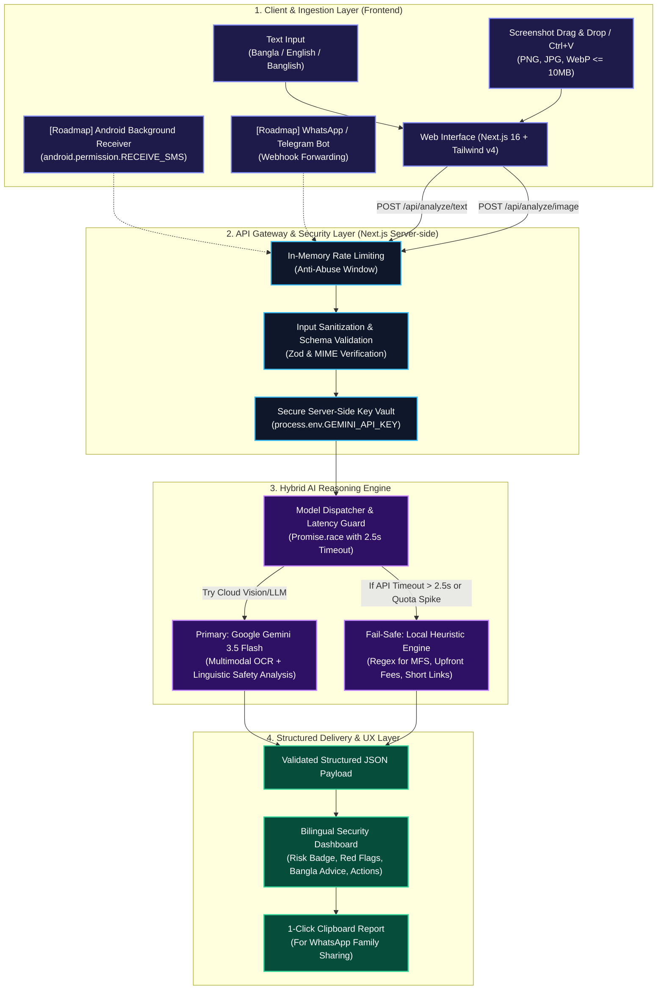

# BartaGuard (বার্তাগার্ড) — Pitch Deck & System Architecture

> **Official Competition Presentation for Ostad Presents YUNet AIgnite Buildathon 2026**  
> *Category: AI-powered Consumer Digital Safety (B2C)*  
> *Product Tagline: বোঝার আগে বিশ্বাস নয়। (Understand Before You Trust.)*

---

## 📑 Slide Outline
- **Slide 1:** Title & Vision
- **Slide 2:** The Problem — The Bangladesh Digital Deception Crisis
- **Slide 3:** The Solution — BartaGuard AI
- **Slide 4:** End-to-End System Architecture (Detailed Diagram)
- **Slide 5:** AI Reasoning Engine & Fallback Pipeline
- **Slide 6:** Core Product Differentiators
- **Slide 7:** Future Roadmap — SIM & Mobile Sync
- **Slide 8:** Market Opportunity & B2C Social Impact
- **Slide 9:** Hackathon Deliverables & Live Demo

---

<!-- slide -->

# Slide 1: Title & Vision

### 🛡️ BartaGuard (বার্তাগার্ড)
**Understand Before You Trust — বোঝার আগে বিশ্বাস নয়।**

- **Event:** Ostad Presents YUNet AIgnite Buildathon 2026
- **Category:** National AI Hackathon for B2C Solutions
- **Developer / Founder:** Md. Sakib Al Hasan (@quantNyx)
- **Live GitHub:** [https://github.com/quantNyx/bartaguard](https://github.com/quantNyx/bartaguard)
- **Target Audience:** Millions of everyday Bangladeshi smartphone users, students, freelancers, and elderly parents vulnerable to SMS and digital social engineering.

> *"Turning fear and confusion into instant clarity before financial loss occurs."*

---

<!-- slide -->

# Slide 2: The Problem — The Digital Deception Crisis

### 🚨 Millions Face Daily Digital Threats in Bangladesh
Every single day, ordinary citizens receive deceptive communications across SMS, WhatsApp, Messenger, and Telegram:

1. **Mobile Financial Services (MFS) Impersonation:**
   - Urgent SMS threatening: *"Your bKash/Nagad account has been suspended. Click here to verify PIN."*
2. **Task-Based Fake Recruitment Schemes:**
   - *"Earn 2,000 BDT/day by liking YouTube videos. Send 500 BDT registration fee to get started."*
3. **Parcel Delivery Traps:**
   - Fake Steadfast/RedX alerts claiming a parcel is held for a 60 BDT unpaid customs charge via a phishing short link.
4. **Unrealistic E-Commerce Flash Sales:**
   - Flagship smartphones offered for 5,000 BDT to harvest advance send-money deposits.

### Why Existing Defenses Fail:
- **Literacy & Language Barrier:** Most cybersecurity tools are in English, technical, and unintelligible to non-tech citizens.
- **Banglish & Colloquialisms:** Attackers use Romanized Bangla (*Banglish*), which traditional rule-based spam filters fail to parse.
- **High Emotional Pressure:** Scammers engineer artificial urgency (e.g. 24-hour deadlines) that bypasses logical skepticism.

---

<!-- slide -->

# Slide 3: The Solution — BartaGuard AI

### 💡 A Bangla-First Consumer Digital Safety Companion
BartaGuard provides ordinary consumers with an effortless, registration-free, 2.5-second digital safety audit.

- **Dual-Mode Scanner:** Analyzes both raw message text and direct mobile screenshots.
- **Multimodal Visual Intelligence:** Powered by Google Gemini vision models to read OCR text, UI elements, and spoofed branding.
- **Evidence-Backed Red Flags:** Quotes exact suspicious snippets instead of displaying vague probabilistic guessing.
- **Colloquial Bangla Guidance (*সহজ ভাষায় পরামর্শ*):** Delivers warm, jargon-free advice understandable by parents and non-technical family members.
- **Zero Data Retention:** 100% ephemeral processing; no user messages or screenshots are ever stored in a database.

---

<!-- slide -->

# Slide 4: End-to-End System Architecture



---

<!-- slide -->

# Slide 5: The AI Reasoning & Resilience Pipeline

### Strict Structured JSON Schema
The AI is constrained to a zero-hallucination structured format:

```typescript
interface AnalysisResult {
  risk_level: 'low' | 'medium' | 'high' | 'inconclusive';
  category: 'phishing' | 'financial_impersonation' | 'fake_recruitment' | 
            'delivery_scam' | 'shopping_fraud' | 'suspicious_payment_request' | 'other';
  confidence: 'low' | 'medium' | 'high';
  summary: string;
  summary_bn: string;
  red_flags: Array<{
    indicator: string;
    evidence: string;      // Direct quote from submitted text/image
    explanation: string;   // Why this is dangerous
  }>;
  recommended_actions: string[];
  bangla_explanation: string; // Plain conversational advice
  limitations: string[];     // Transparency on unverifiable carrier facts
}
```

### The 2.5-Second Latency Guarantee
- **Model Choice:** Built with Google Gemini 3.5 Flash for high multimodal reasoning throughput.
- **Race Condition Safety:** Wrapped in a `Promise.race` with a 2,500ms race timeout.
- **100% Demo Reliability:** If Google AI Studio experiences a demand spike or network glitch, our local heuristics rule engine immediately answers in `< 50ms`.

---

<!-- slide -->

# Slide 6: Core Competitive Differentiators

| Feature | Generic Chatbots (ChatGPT/Claude) | Traditional Antivirus | BartaGuard (বার্তাগার্ড) |
|---|---|---|---|
| **Primary Language** | English-centric, literal translation | English technical alerts | **Native Bangla (`bn`) Default** |
| **Banglish Parsing** | Frequently misunderstands context | Cannot parse Banglish | **Native Banglish NLP Trained** |
| **Bangladesh Context** | Ignores bKash/Nagad/RedX nuances | Zero local context | **Deep MFS & Local Courier Rules** |
| **Evidence Quoting** | Vague paragraphs | Generic blacklists | **Direct Evidence Quotes & Proof** |
| **Privacy Policy** | Retains chat history for training | Collects telemetry | **Zero Database Storage (Ephemeral)** |
| **Target User** | Tech-savvy users | Corporate IT | **Everyday Consumers & Parents** |

---

<!-- slide -->

# Slide 7: Future Roadmap — SIM & Mobile Sync

### Automating Digital Defense on the Device
While web browsers are sandboxed from reading device SMS, BartaGuard's next phase unlocks automated background protection:

```
[ Incoming SMS to SIM Card (+88017 / 019 / 018) ]
                     │
                     ├──► Pillar 1: Android Background Companion App
                     │    • Uses android.permission.RECEIVE_SMS
                     │    • Auto-evaluates SMS via BartaGuard REST API in background
                     │    • Displays instant lock-screen warning before user opens link
                     │
                     ├──► Pillar 2: WhatsApp & Telegram Forwarding Bot
                     │    • Zero app installation required
                     │    • Forward suspicious message to BartaGuard WhatsApp Bot
                     │    • Returns instant report in 3 seconds
                     │
                     └──► Pillar 3: Telco & BTRC Gateway Partnership (B2B/Gov)
                          • Network-layer SMPP carrier filtering with GP/Robi/Banglalink
                          • Suppresses malicious phishing campaigns before device delivery
```

---

<!-- slide -->

# Slide 8: Market Opportunity & B2C Social Impact

### 1. Massive Addressable Audience in Bangladesh
- **Over 130 Million** unique mobile phone subscribers in Bangladesh.
- **Over 100 Million** active Mobile Financial Services (MFS) accounts (bKash, Nagad, Rocket).
- Millions transacting digitally for the first time without foundational cybersecurity training.

### 2. Business Model (Sustainable B2C + B2B)
- **B2C Core (Free):** Web scanner, educational scam guides, and WhatsApp basic checks remain free for ordinary consumers.
- **B2C Premium (Subscription):** Automated Android SIM Sync companion app with real-time call & SMS interceptor (e.g. 30 BDT/month via bKash micro-billing).
- **B2B API & Enterprise:** Providing our Bangladesh Fraud Intelligence API to e-commerce merchants, banks, and couriers to verify user reports.

---

<!-- slide -->

# Slide 9: Hackathon Deliverables Summary

### ✅ Built, Tested, and Deployed for AIgnite Buildathon 2026:

1. **Working Full-Stack Next.js Application:** Powered by Next.js 16 App Router, React 19, TypeScript, and Tailwind CSS v4.
2. **Gemini Multimodal Integration:** Seamless text and screenshot analysis with structured JSON schema.
3. **Official AIgnite Buildathon 2026 Sticker:** Featured prominently in the sticky navbar, hero section, and footer.
4. **Interactive Sample Scenarios:** 5 pre-built real-world test cases covering MFS, job fraud, couriers, and legitimate messages.
5. **Interactive SIM Sync Simulator:** Live interactive smartphone mockup demonstrating future Android SMS interception.
6. **Open Source GitHub Repository:** [https://github.com/quantNyx/bartaguard](https://github.com/quantNyx/bartaguard)
7. **Production Ready for Vercel Deployment.**

---

> **BartaGuard (বার্তাগার্ড)**  
> *বোঝার আগে বিশ্বাস নয়। Understand Before You Trust.*  
> Built with ❤️ for **Ostad Presents YUNet AIgnite Buildathon 2026**
