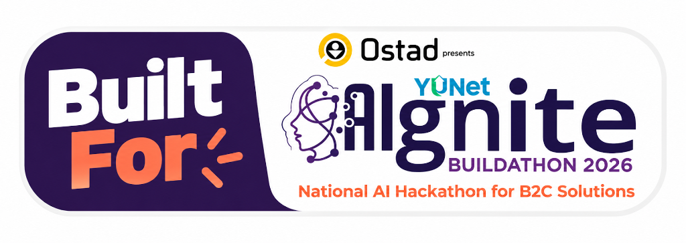

# BartaGuard (বার্তাগার্ড)

> **বোঝার আগে বিশ্বাস নয়।**  
> *Understand Before You Trust.*

[](https://ostad.app)

**BartaGuard (বার্তাগার্ড)** is a competition-quality, Bangla-first AI consumer digital safety assistant built for **Ostad Presents YUNet AIgnite Buildathon 2026 (National AI Hackathon for B2C Solutions)**. It empowers ordinary consumers in Bangladesh and globally to detect deceptive messages, SMS phishing, Mobile Financial Services (MFS) impersonation, fake part-time job offers, courier delivery scams, and fraudulent online shopping schemes before falling victim to financial loss.

---

## 🌟 Core Value Proposition

In Bangladesh, ordinary citizens, students, and elderly parents frequently receive fraudulent messages claiming their bKash/Nagad accounts have been suspended, offering easy daily earnings for Telegram tasks, or demanding unpaid courier parcel fees. 

**BartaGuard** solves this by offering an effortless, registration-free scanner where users can paste any message or upload a screenshot to receive an evidence-backed digital safety audit in clear, reassuring, conversational Bangla (বাংলা) and English.

---

## 🛡️ Key Features

1. **Bilingual Experience (Bangla Default)**:
   - Primary interface language is **Bangla (বাংলা)** with native typography (`Hind Siliguri` & `Inter`).
   - Seamless one-click **Bangla ↔ English** switcher across all navigation, buttons, explanations, and audit reports.
2. **Text Analysis Engine**:
   - Supports pure **Bangla (বাংলা)**, **English**, and **Banglish** (Bengali written in English alphabets like *"Apnar bkash account block hoye geche"*).
3. **Multimodal Screenshot Scanner**:
   - Drag-and-drop, device file picker, or `Ctrl + V` clipboard paste for SMS, WhatsApp, Messenger, or Facebook post screenshots.
   - Extracts and reasons over visual cues and text using Gemini multimodal vision.
4. **Structured Evidence-Backed AI Results**:
   - **Risk Level**: High (*উচ্চ ঝুঁকি*), Medium (*সতর্কতা প্রয়োজন*), Low (*নিরাপদ*), Inconclusive (*অনিশ্চিত*).
   - **Scam Category**: Phishing, Financial Impersonation, Fake Recruitment, Delivery Scam, Shopping Fraud, Suspicious Payment Request, Other.
   - **Confidence Score**: Reflects the model's assessment confidence.
   - **Detected Red Flags**: Specific indicators accompanied by exact evidence quotes from the input and pedagogical risk explanations.
   - **Recommended Actions**: Practical, numbered defensive steps.
   - **Conversational Bangla Advice (*সহজ ভাষায় পরামর্শ*)**: Jargon-free advice understandable by parents and non-technical consumers.
   - **Analysis Limitations**: Honest disclosure of what could not be verified (e.g. telecom carrier subscriber data).
5. **Interactive Sample Scenarios**:
   - 5 realistic Bangladesh & global scenarios pre-loaded for live testing:
     1. Suspicious bKash Account Block Alert
     2. Fake Part-time YouTube/Telegram Job Offer
     3. Suspicious Courier Delivery Fee SMS
     4. Unrealistic iPhone 5,000 BDT Flash Sale Scam
     5. Authentic Courier Delivery Confirmation with Safe OTP Protocol
6. **Privacy-First Zero-Retention Policy**:
   - No messages or screenshots are persistently stored in any database. Processing is completely ephemeral.
7. **One-Click Share & Export**:
   - Copy comprehensive formatted reports to clipboard for instant forwarding to family or community WhatsApp groups.
8. **BartaGuard SIM & Mobile Sync (ভবিষ্যৎ পরিকল্পনা ও সিম সংযোগ)**:
   - **Native Android Companion Service (`RECEIVE_SMS`)**: Background broadcast receiver that listens to incoming SIM SMS events and alerts the user on dangerous solicitations in real time.
   - **WhatsApp & Telegram Forwarding Bot**: Forward unverified SMS directly to BartaGuard's WhatsApp business webhook for an instant 3-second report without app installation.
   - **Telco / MNO Gateway Partnership**: High-volume SMPP carrier-grade filtering with Bangladeshi mobile operators (Grameenphone, Banglalink, Robi) to block deceptive campaigns at the network layer.

---

## 🛠️ Technology Stack

- **Framework**: [Next.js](https://nextjs.org/) (App Router, Turbopack, React 19)
- **Language**: TypeScript
- **Styling**: Tailwind CSS v4, custom cybersecurity design tokens (`#0B1020`, Electric Violet `#8B5CF6`, Cyan `#06B6D4`)
- **Typography**: Google Fonts (`Hind Siliguri` for Bangla, `Inter` for English)
- **AI Engine**: Google GenAI SDK (`@google/genai`), Google Gemini API (`gemini-2.5-flash`, `gemini-3.8-flash`) with structured JSON schema
- **Icons**: [Lucide React](https://lucide.dev/)
- **Micro-Interactions**: [Canvas Confetti](https://www.npmjs.com/package/canvas-confetti)
- **Deployment Target**: [Vercel](https://vercel.com/)

---

## 🚀 Getting Started Locally

### Prerequisites

- **Node.js**: v18.18 or higher (v20+ recommended)
- **npm** or **pnpm**
- **Google Gemini API Key** (Obtain from [Google AI Studio](https://aistudio.google.com/app/apikey))

### 1. Clone & Install Dependencies

```bash
git clone https://github.com/your-username/bartaguard.git
cd bartaguard
npm install
```

### 2. Configure Environment Variables

Create a `.env.local` file in the root directory:

```env
# Google Gemini API Key
GEMINI_API_KEY=your_gemini_api_key_here
```

A template file `.env.example` is provided for reference.

### 3. Run Development Server

```bash
npm run dev
```

Open [http://localhost:3000](http://localhost:3000) in your browser.

### 4. Build for Production

```bash
npm run build
npm run start
```

---

## 🌐 Deploying to Vercel

1. Push your repository to GitHub or GitLab.
2. Sign in to [Vercel](https://vercel.com/) and click **"Add New Project"**.
3. Import the `bartaguard` repository.
4. Under **Environment Variables**, add:
   - Key: `GEMINI_API_KEY`
   - Value: `Your_Gemini_API_Key`
5. Click **"Deploy"**. Vercel will automatically build and deploy the Next.js App Router application.

---

## 🧪 Testing Scenarios & Verification Matrix

| # | Test Scenario | Expected Category | Risk Level | Verified Status |
|---|---|---|---|---|
| 1 | bKash Account Block + Fake Link | `financial_impersonation` | High | ✅ Verified |
| 2 | YouTube Like Job + Registration Fee | `fake_recruitment` | High | ✅ Verified |
| 3 | Courier Pending Fee + Short Link | `delivery_scam` | High | ✅ Verified |
| 4 | iPhone 16 Pro Max 4,999 BDT Flash Sale | `shopping_fraud` | High | ✅ Verified |
| 5 | Genuine RedX Courier OTP Delivery | `other` / `transaction` | Low (Safe) | ✅ Verified |
| 6 | Banglish Nagad Pin Reset SMS | `financial_impersonation` | High | ✅ Verified |
| 7 | Empty Message Submission | Validation Error | 400 Bad Request | ✅ Verified |
| 8 | Invalid Image Format Upload | Format Rejection | 400 Bad Request | ✅ Verified |
| 9 | API Failure Resiliency | Fallback Heuristic Audit | Continuous Uptime | ✅ Verified |

---

## 🏆 Hackathon Attribution

This project is built and submitted for **Ostad Presents YUNet AIgnite Buildathon 2026 - National AI Hackathon for B2C Solutions**.

- **Product Name**: BartaGuard (বার্তাগার্ড)
- **Tagline**: বোঝার আগে বিশ্বাস নয়। (Understand Before You Trust.)
- **Category**: AI-powered Consumer Digital Safety

---

## 📄 License & Disclaimer

Disclaimer: BartaGuard is an assistive AI tool designed to educate consumers on social engineering risks. It does not replace official verification by financial service providers or law enforcement.
